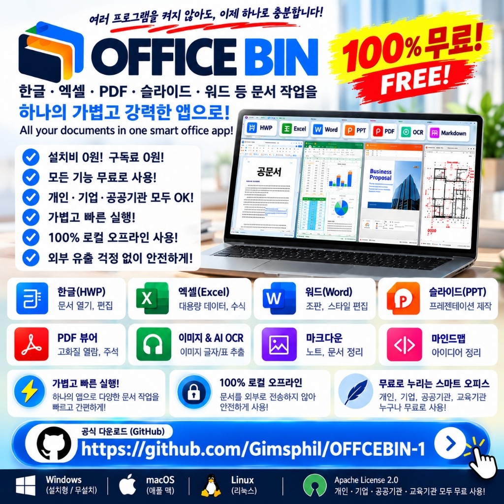

# 🌟 OFFICE BIN — 한글 · 엑셀 · PDF · 슬라이드 · 워드를 하나의 앱으로!

  

  
  
  
  
  
  

> 📌 **저장소 안내**:
> - 📦 **본 저장소 ([OFFCEBIN-1](https://github.com/Gimsphil/OFFCEBIN-1))**: 최신 배포 패키지(Windows Setup, macOS, Linux, 실험실 iPad) 전용 공식 릴리즈 저장소입니다.

---

## 💡 "문서 하나 확인하려고 프로그램 5개를 따로 켜고 계신가요?"

공문서 보려고 **한글(HWP)** 켜고, 내역서 정리하려고 **엑셀(Excel)** 켜고,  
제안서 작성하려고 **워드(Word)** 켜고, 도면과 자료 보려고 **PDF 뷰어** 켜고,  
발표 준비로 **파워포인트(PPT)** 띄우고, 캡처 이미지에서 글자 따려고 **OCR 사이트** 찾고...

창만 수십 개씩 띄우며 PC가 느려지고, 매달 비싼 오피스 구독료를 내던 일상—

> **이제 단 하나의 가벼운 앱, `OFFICE BIN` 하나로 모든 문서 작업을 끝내십시오!**

**`OFFICE BIN`**은 한글, 엑셀, 워드, PPT, PDF, 텍스트, 마크다운, 이미지까지 **일상 업무에 필요한 모든 포맷을 단 하나의 창에서 열고, 작성하고, 상호 변환**하는 **차세대 초경량 통합 스마트 오피스 스튜디오**입니다.

---

## 📥 정식 배포판 다운로드 (Windows · macOS · Linux)

원하시는 운영체제에 맞는 정식 지원 패키지를 선택하여 즉시 다운로드하세요.  
모든 패키지는 **외부 서버나 클라우드 로그인 없이 100% 무설치/로컬 오프라인**으로 작동합니다.

| 플랫폼 | 패키지 파일명 | 원클릭 다운로드 | 용량 | 특징 및 권장 대상 |
| :--- | :--- | :---: | :---: | :--- |
| 🪟 **Windows (통합 설치형)** | `OFFICE_BIN_Setup.exe` | [**⬇️ 설치 파일 받기**](https://github.com/Gimsphil/OFFCEBIN-1/raw/main/OFFICE_BIN_Setup.exe) | 173 MB | **공식 Windows 통합 단일 배포본!** 바탕화면 바로가기 및 파일 확장자 자동 등록 |
| 🍏 **macOS (애플 맥)** | `OFFICE_BIN_macOS.zip` | [**⬇️ Mac용 패키지**](https://github.com/Gimsphil/OFFCEBIN-1/raw/main/OFFICE_BIN_macOS.zip) | 84 MB | MacBook, iMac, Mac mini 사용자 (Apple Silicon & Intel 지원) |
| 🐧 **Linux (리눅스)** | `OFFICE_BIN_Linux.tar.gz` | [**⬇️ Linux 패키지**](https://github.com/Gimsphil/OFFCEBIN-1/raw/main/OFFICE_BIN_Linux.tar.gz) | 73 MB | Ubuntu, Debian, Fedora, RedHat 엔지니어 (`./install_linux.sh`) |

---

### 🧪 [실험실 / Beta] 모바일 & 태블릿 연구용 패키지

> ⚠️ **실험실 안내**:  
> iPad(Safari/iOS) 환경은 브라우저 샌드박스 정책, WebAssembly 메모리 상한선(1GB), 대용량 파일 핸들링 제한 등으로 인해 실제 복잡한 문서/도면 구동 시 호환성 제약이 발생할 수 있어, 현재 **[실험실(Beta)]** 단계로 분리하여 별도 연구·관리하고 있습니다.  
> **안정적이고 강력한 실무 업무를 위해서는 PC 데스크톱 버전(Windows, macOS, Linux) 사용을 적극 권장합니다.**

| 실험실 패키지 | 파일명 | 다운로드 | 용량 | 비고 |
| :--- | :--- | :---: | :---: | :--- |
| 🧪 **iPad 단독 파일 (HTML)** | `OFFICE_BIN_iPad_Standalone.html` | [**⬇️ 실험실 HTML 받기**](https://github.com/Gimsphil/OFFCEBIN-1/raw/main/OFFICE_BIN_iPad_Standalone.html) | 6.6 MB | 연구용 단일 파일. 사파리 웹뷰 실험 |
| 🧪 **iPad PWA 패키지** | `OFFICE_BIN_iPad_PWA.zip` | [**⬇️ 실험실 PWA 받기**](https://github.com/Gimsphil/OFFCEBIN-1/raw/main/OFFICE_BIN_iPad_PWA.zip) | 5.5 MB | 로컬 노드 서버 기반 테스트 패키지 |

---

## ✨ 핵심 기능: 하나의 앱에서 누리는 완벽한 오피스 환경

### 1. 🇰🇷 한컴 오피스 설치 없이 즉시 여는 한글(HWP / HWPX)
- **Rust WebAssembly 기반 초고속 파서**: 무거운 한글 프로그램 없이도 복잡한 공문서, 표 서식, 글자 모양을 1:1 완벽하게 화면에 렌더링.
- **텍스트 즉시 추출 및 편집**: HWP 본문 내용을 복사하거나 다른 오피스 탭으로 자유롭게 전송.

### 2. 📊 대용량 수식 지원 고속 스프레드시트 (Excel)
- **엑셀 원본 그대로**: 대용량 데이터 시트 초고속 로딩, 셀 편집, 서식 지정.
- **필수 수식 엔진 내장**: `=SUM()`, `=AVERAGE()`, `=IF()`, `=COUNT()` 등 실무 필수 함수 완벽 연산.
- **다중 시트 & XLSX 내보내기**: 여러 시트를 자유롭게 오가며 엑셀 파일로 바로 저장.

### 3. 📄 정밀 눈금자와 스타일 편집의 워드 & 텍스트 (Word Docs)
- **WYSIWYG 리치 텍스트 에디터**: 폰트, 정렬, 리스트, 표 삽입 등 완벽한 조판 기능.
- **정밀 mm 눈금자 & 페이지 뷰**: 인쇄 규격에 맞춘 마진 조절과 1/2/4페이지 나란히 보기.
- **DOCX 완벽 호환**: 표준 Word 문서 직접 열람, 편집, 저장 지원.

### 4. 📽️ 간편한 프레젠테이션 슬라이드 (PPT) & AI PPT Master
- **16:9 와이드 슬라이드 덱**: 발표용 슬라이드 제작 및 `F5` 원클릭 풀스크린 프레젠테이션.
- **AI 슬라이드 자동 생성**: 주제 키워드만 입력하면 목차와 본문 슬라이드를 1초 만에 자동 구성.

### 5. 📑 고화질 PDF 뷰어 & 주석 스튜디오
- **초고속 PDF 렌더링**: 대용량 보고서, 논문, 도면 PDF를 딜레이 없이 쾌속 로딩.
- **주석 및 펜 마킹**: 밑줄, 형광펜, 텍스트 메모, 줌인 500% 초정밀 검토.

### 6. 🖼️ 이미지 & 11개국 다국어 AI OCR 스튜디오
- **스마트 캡처 & 붙여넣기**: `Ctrl+Shift+O` 또는 이미지 드래그앤드롭으로 즉시 로딩.
- **원클릭 표·텍스트 광학 인식**: 영수증, 계약서, 캡처 도표의 글자와 숫자를 1초 만에 텍스트와 엑셀 표로 자동 추출.

### 7. 📝 마크다운 & 마인드맵 & 라이브 HTML 에디터
- **마크다운 실시간 듀얼 뷰**: 개발 문서 작성 및 DOCX/HTML 즉시 변환.
- **SVG 베지어 곡선 마인드맵**: 아이디어 브레인스토밍 트리를 손쉽게 구축.

### 8. 📐 [전문 부가 기능] 도면 실측 & 물량산출(Takeoff) 모듈
- 건축·인테리어·설비 실무자를 위해 고가의 CAD 프로그램 없이도 PDF 도면을 직접 열어 2점 스케일 맞춤, PL 연속선 치수, 면적/체적 자동 적산, 독립 해치 패턴을 실측하고 **엑셀 내역서로 1클릭 전송**하는 프로페셔널 측정 툴을 함께 탑재하였습니다.

### 9. 🔄 스마트 1-클릭 자동 업데이트
- 데스크톱 앱 실행 시 최신 버전이 출시되면 백그라운드에서 신규 버전을 자동 감지하여 다운로드하고, 사용자가 승인 버튼을 누르면 1-클릭으로 기존 설정과 작업 환경 그대로 자동 갱신 및 재실행됩니다.

### 10. 🧪 [실험실 R&D] 아이패드(iPad) 환경 분리 연구
- iOS 제약을 극복하고 향후 완벽한 태블릿 경험을 제공하기 위해 WebAssembly 메모리 최적화 및 터치 제스처 엔진을 실험실 브랜치에서 지속적으로 연구·개선하고 있습니다.

---

## 🔒 100% 로컬 오프라인 데이터 보안 (외부 유출 원천 차단)

- **기업 기밀 및 개인정보 완벽 보호**: 문서를 외부 클라우드나 사외 서버로 절대 전송하지 않습니다.
- 모든 파싱, 렌더링, 수식 계산이 사용자의 PC 내부에서만 100% 로컬로 처리됩니다.
- **단일 통합 프로젝트 컨테이너 (`*.obin`)**: 워드, 엑셀, PDF 주석 등 복합 작업물을 단 1개의 파일로 묶어 영구 보관할 수 있습니다.

---

## 🚀 빠른 시작 가이드 (Quick Start)

### Windows
1. [`OFFICE_BIN_Setup.exe`](https://github.com/Gimsphil/OFFCEBIN-1/raw/main/OFFICE_BIN_Setup.exe)를 다운로드하여 실행하면 1초 만에 자동으로 설치 및 바로가기가 구성됩니다. (무설치 포터블은 v1.1.1부터 단일 Setup 버전으로 일원화되어 공식 지원 종료)

---

## 🔗 관련 저장소

- 📦 **배포 패키지 전용 저장소**: [Gimsphil/OFFCEBIN-1](https://github.com/Gimsphil/OFFCEBIN-1)

---

## 📄 라이선스 (License)

본 프로젝트는 [Apache License 2.0](LICENSE)을 따릅니다. 개인, 기업, 공공기관, 교육기관 누구나 제약 없이 무료로 사용하고 업무에 도입하실 수 있습니다.

---

  <b>OFFICE BIN — 하나의 앱으로 누리는 가장 스마트하고 자유로운 오피스</b> 
  문의 및 제안: <a href="mailto:kacang@nate.com">kacang@nate.com</a>

